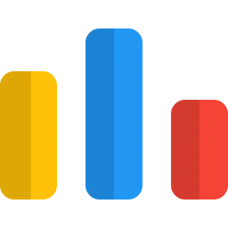

<!-- markdownlint-disable MD041 -->

<!-- HEADER BANNER & VISITOR COUNTER -->

  

 

  

<!-- SOCIAL & COMPETITIVE PROGRAMMING LINKS -->
<h5 align="center">
  <code><a href="https://www.linkedin.com/in/ananya-in-tech/" title="LinkedIn Profile"> LinkedIn</a></code>
  <code><a href="https://youtube.com/@ananya_in_tech" title="YouTube Profile"> YouTube</a></code>
  <code><a href="https://stackoverflow.com/users/32182648/ananya-in-tech" title="Stack Overflow Profile"> Stack Overflow</a></code>
  <code><a href="https://atcoder.jp/users/ananya_in_tech" title="AtCoder Profile"> AtCoder</a></code> -->
  <code><a href="https://codeforces.com/profile/ananya-09" title="CodeForces Profile"> CodeForces</a></code>
  <code><a href="https://leetcode.com/u/ananya-in-tech/" title="LeetCode Profile"> LeetCode</a></code>
</h5>

 

---

<!-- ABOUT ME SECTION -->

    

      Hi, I'm Ananya, GSoC '26 Contributor & Open-Source Contributor 🚀
       
      🎓 Pursuing my B.Tech in Civil Engineering
       
      💻 Contributing as a GSoC '26 Contributor with the OWASP Foundation on BLT-Vanish
       
      💡 Ex-Co-Lead at GDG on Campus & Ex-Executive Member at FLUX Society
       
      🌐 Passionate about building web applications with the MERN stack & open-source community growth
       
      📚 I’m currently sharpening my DSA skills & building scalable full-stack projects
       
      ✨ I love exploring cozy tech aesthetics, journaling, and solving real-world problems through code
       
       
      💬 Let's discuss about tech and more <a href="https://github.com/ananya-in-tech/ananya-in-tech/discussions" title="Discussions">here</a>
       
      <i> > Don't forget to tag/mention my github ID <a href="https://github.com/ananya-in-tech" title="Ananya in Tech Github ID">@ananya-in-tech</a> to get me notified for your queries</i>
       
       
      📫 Reach me at: <a href="mailto: ananyar0912@gmail.com">ananyar0912@gmail.com</a> <i>Profestional Only<i>
    

---

<!-- TECH STACK & TOOLS -->
## 🛠️ Tech Stack & Skills

  

    
    
  

  

    
    
    
    
  

  

    
  

<!-- markdownlint-enable MD033 -->

---

<!-- DISCUSSIONS & COMMUNITY -->
## 💬 Let's Connect & Discuss!

Have a question about **GSoC**, open-source, web development, or community building? Or just want to say hi? 

* 💬 **Ask a question or start a discussion:** Head over to my [GitHub Discussions](../../discussions) tab!
* 📌 **What you can ask me about:**
  * Getting started with Open-Source & GSoC
  * Web & App development
  * Community building & leadership
  * Tech recommendations & resources
  * Data Structures & Algorithms

...and many more

> 💡 *Feel free to open a thread under **Q&A**—I'd love to connect and help out where I can!*

---

<!--
**ananya-09/ananya-09** is a ✨ _special_ ✨ repository because its `README.md` (this file) appears on your GitHub profile.

Here are some ideas to get you started:

- 🔭 I’m currently working on ...
- 🌱 I’m currently learning ...
- 👯 I’m looking to collaborate on ...
- 🤔 I’m looking for help with ...
- 💬 Ask me about ...
- 📫 How to reach me: ...
- 😄 Pronouns: ...
- ⚡ Fun fact: ...
-->
